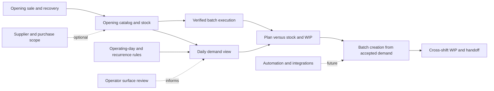

# Kalali product roadmap

<!-- docs:policy-allow: handoff -->

This roadmap combines the recovered operational requirements of SKOSS with the capabilities of
FloCafe and the Kalali production extension. It describes product intent, not supported behavior.
See [requirements](requirements/skoss-requirements.md) for source traceability and
[implementation status](implementation-status.md) for code-backed coverage. This document keeps
business requirements separate from technical decisions.

## Product outcome

Kalali needs reliable sale, preparation, stock recording and safe recovery at opening. The longer
operating goal is to make demand, recurring work, production batches, work in progress and shift
handover visible as one operator workflow. Existing FloCafe POS, inventory, printing, permissions
and Kalali production services are the starting capabilities; SKOSS is a source of workflow
requirements, not an architecture to transplant.

## Opening MVP

The opening MVP is an operational readiness outcome, not a new feature suite.

### Scope

- Store and staff setup with backend-enforced access control.
- Sell and fulfill cafe/bakery products, accept payment, print required customer/kitchen artifacts.
- Load opening catalog, relevant recipes and supplies; establish traceable opening balances.
- Execute and reconcile a production batch with planned quantity, actual yield, process state and
  inventory movements.
- Operate core POS, kitchen and printing flows without an internet connection.
- Rehearse backup and restore on isolated data and confirm recovery does not lose records.
- Provide a usable shift-to-shift procedure, whether through the current UI or a documented
  interim operating method.

### Exit criteria

1. A staff member with appropriate permission can sell, pay, prepare and print an order end to end.
2. A batch can be started and completed once; retries do not duplicate ingredient consumption or
   output credit.
3. Actual yield and stock movements reconcile, and changes are attributable to the authenticated
   actor.
4. Core sale and production actions remain available without internet; optional integrations fail
   gracefully.
5. A recovery rehearsal restores an isolated backup and preserves valid data.
6. Kalali owners approve the operating-day, stock-opening and handoff checklist.

The opening MVP does not require recurring customer orders, internal recurring tasks, demand
forecasting, purchase orders, a new operator app or advanced analytics. Existing configured
capabilities may be used, but they are not prerequisites unless Kalali confirms otherwise.

## Operation SKOSS completa

This stage connects the operational backbone beyond opening:

1. Consolidate eligible orders, scheduled orders and confirmed recurring occurrences into demand
   by operational day and product/family.
2. Compare demand with finished/intermediate stock, committed stock and active WIP under explicit
   availability rules.
3. Create production orders from accepted requirements without duplicate batches; preserve recipe
   and process snapshots.
4. Carry batch quantities and step state across interruptions and shifts; distinguish WIP from
   inventory held as a supply.
5. Capture short yield, discard, substitution, blockage and changed demand without silently
   adjusting planned values.
6. Record the minimum handoff context for the next authorized operator.
7. Add recurring internal tasks only after schedule, ownership and exception rules are agreed.
8. Add supplier, quote, receiving and cost flows only to the depth Kalali validates.
9. Report planned versus actual production, stock consumption, remaining demand and handoff risks.

## Evolución

Keep these capabilities independent of the core operating loop and evaluate separately:

- Multi-device operator usability improvements using existing FloCafe surfaces first.
- Additional automation or optional integrations that preserve offline core behavior.
- Public web ordering, delivery platform integrations and messaging.
- Advanced analytics, capacity modeling and resource scheduling.
- PWA/client packaging or ARM64 deployment after a concrete device/deployment need is established.

SKOSSina names a worker-facing experience. For Kalali it is a product/UX reference, not a mandate
to create a separate app or client architecture.

## Dependencies

The opening track and product discovery can proceed independently of the SKOSS demand planner.
Printing/device review and recurring-order discovery can also progress independently. Do not
couple procurement depth to batch lifecycle unless validated cost or receiving requirements make
that dependency necessary.

## First ten implementable tasks

Effort is a planning range for one engineer familiar with FloCafe: S = 2–5 days, M = 1–2 weeks,
L = 3–6 weeks. Estimates include focused implementation and verification; discovery duration is
not included. These are tasks to refine, not authorization to implement within this documentation
change.

| Rank | Task | Value and acceptance | Dependencies | Tests / verification | Size | Independent track |
| --- | --- | --- | --- | --- | --- | --- |
| 1 | Specify Kalali production day/cutoff with operators | One agreed business-local boundary handles overnight production, demand and reports | Operator walkthrough | Examples spanning midnight, DST/timezone boundary as relevant, date filters | S | Yes; discovery |
| 2 | Rehearse opening sale, payment, print, offline and recovery | Written checklist passes with synthetic isolated data | Store setup, roles, printer and backup path | Existing order/payment, printer, offline and restore suites; manual device rehearsal | S–M | Yes; opening |
| 3 | Validate catalog, recipes and opening inventory loading | Opening quantities and sellable catalog reconcile without hidden stock edits | Units, recipe inputs, opening procedure | Import/recipe/inventory ledger, backup/restore, upgrade safety | M | Yes; opening |
| 4 | Run a synthetic end-to-end Kalali production batch | Recipe issue, process steps, yield and output reconcile once | Task 3; production permissions | `test:production-batches`, `test:production-processes`, `test:production-api`, recipe/order lifecycle | M | Yes; opening |
| 5 | Define read-only daily demand projection | Eligible order lines group by production date/product and reconcile to source lines | Task 1; order state rules | Service/API tests for edits, cancel, scheduled release, timezone | M | Yes; can prototype from fixtures |
| 6 | Review operator surface mapping by station | Each station has the required action using POS/KDS/Server App or a proven gap | Device/role inventory | Permission matrix review and browser/E2E walkthrough | S–M | Yes; UX discovery |
| 7 | Specify demand-to-batch contract and retry behavior | Batch generation is explicit, idempotent, snapshot-preserving and handles changed demand | Tasks 4–5 | Contract tests covering retries, edits, cancellation and authorization | M | After task 5; independent of UI polish |
| 8 | Define WIP versus intermediate-stock semantics | Operators can classify each example without double-counting; quantity/unit ownership is clear | Operator walkthrough; process/stock review | Scenario table and ledger reconciliation design | S | Yes; discovery |
| 9 | Specify recurring bakery order exceptions | Series, occurrences, horizon, edit scope and duplicate prevention are agreed | Task 1; customer/order examples | Recurrence tests for retries, exceptions, time boundaries and edits | S–M | Yes; discovery |
| 10 | Decide supplier/purchase/cost evidence depth | Distinguish quote, order, receipt, invoice and on-hand balances; preserve selected historical cost rule | Current purchasing records | Scenario review; ledger/cost integrity plan | S | Yes; discovery |

## Compatibility and data constraints

- Keep SQLite and FloCafe's migration/restore contracts unless a separate, evidence-backed product
  requirement justifies another choice.
- Extend the Kalali production service rather than creating a second batch subsystem.
- Preserve upstream-compatible changes as focused, reusable improvements when possible; keep
  Kalali-specific workflow configuration isolated when it is not generic.
- Treat supply balances, committed quantities, active production and WIP as distinct concepts.
- Do not add a migration until the relevant business rules are resolved. Use forward migrations
  and test fresh and populated upgrade paths with synthetic databases.
- Keep authorization, payment, tax, stock movement, idempotency and audit decisions backend-side.

## Decision ownership

The open operating decisions are recorded in [discovery questions](discovery/open-questions.md).
Resolve them with Kalali operators before finalizing data contracts. Architecture decisions belong
in `docs/decisions/` only after a technical choice is actually made.
